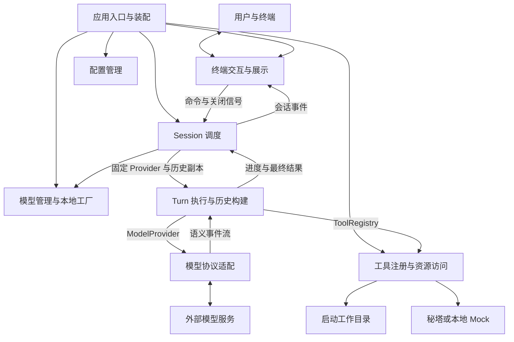

# 架构总览

核对日期：2026-10-30。本文描述当前源码的整体结构；后续调整见 [架构演进](evolution.md)，
实际验证结果见根 [README](../../README.md)。逻辑模块不等同于 Rust module 或 Cargo crate。

## 系统定位与边界

Vortex 是用于学习 Rust 与 CLI Agent 实现细节的终端 Agent，二进制名为 `vortex`。
当前主链路是交互式 TUI：接收用户输入，串行调度模型与工具，将正文和公开思考增量
投影到界面；会话事实保存在进程内存中。另有未迁移的旧 `exec` 单次 HTTP 路径。

系统外部包括终端、模型 HTTP 服务、秘塔搜索服务、启动工作目录和用户配置/日志目录。
模型决定是否请求工具，程序校验协议、调用 ID 和预算并执行已注册能力；
当前没有通用权限审批、Shell、文件写入或 OS 沙箱，不能将执行限制视为完整安全隔离。

## 逻辑架构

图中箭头表示运行时协作，不是 Cargo 依赖。八个逻辑模块的接口、状态归属和源码映射
见 [逻辑模块](logical-modules.md)，关键调用顺序见 [运行链路](runtime-flows.md)。
共享 Diagnostics 提供横切的开发期 HTTP 诊断，不参与模型/工具调度，未画入上面的业务链路。

## 依赖方向

当前 manifest 中的兄弟 crate 依赖如下；完整图见 [仓库组织](repository-structure.md)：

- CLI 依赖 Core、Provider、Tools、TUI 和 Diagnostics，承担具体实现的组合装配。
- Provider、Tools、TUI 分别依赖 Core，彼此不依赖；Provider/Tools 另依赖 Diagnostics。
- Diagnostics 不依赖任何兄弟 crate；Core/TUI 不依赖它，文件日志初始化仍在 CLI。
- Core 不依赖任何兄弟 crate，也不依赖 Reqwest、Ratatui 或 Crossterm。
- Sandbox 是独立 workspace 成员，目前只有模板函数和测试，没有产品依赖指向它。

依赖倒置通过 Core 的 `ModelProvider`、`ModelFactory` 和 `Tool` trait 实现。
Core 调用注入对象，不需要依赖实现这些接口的 crate。Core 不是纯类型包：它已使用
Tokio 调度任务，并在 `config.rs` 中执行同步配置文件读取。

## crate 职责

| crate | 当前职责 | 当前边界 |
| --- | --- | --- |
| `vortex-cli` | 参数、路径、日志、启动装配、具体模型工厂与旧 exec | TUI 使用统一 Session；exec 尚未复用它 |
| `vortex-core` | 配置、模型绑定、会话调度、Turn loop、历史语义及 Provider/Tool 接口 | 无模型 HTTP、终端控件、持久化或审批实现 |
| `vortex-diagnostics` | 共享请求关联、正文副本脱敏/截断及错误预览 | wire_trace 仅在 debug_assertions 下编译；不初始化 subscriber、不调度业务 |
| `vortex-provider` | OpenAI-compatible Chat Completions 请求、思考选项适配、HTTP/SSE 与解码 | 不选择任务、不决定何时执行工具 |
| `vortex-tools` | 目录列表、工作区句柄、秘塔与 Mock 搜索 | 不调度模型；没有 MCP 或文件编辑/Shell |
| `vortex-tui` | 输入与 slash、状态投影、Effect、控件与终端生命周期 | 不读取密钥，不持有具体 Provider，不保存权威历史 |
| `vortex-sandbox` | 模板占位 | 尚未提供隔离或审批能力 |

## 数据与控制边界

Session 独占权威 `Vec<ConversationItem>`、状态与 `ModelManager`；每个 Turn 获取固定的
Provider、工具额度规则和历史副本。一次模型响应可声明多个调用，本地顺序执行；
Session 先保存一条批次声明，再逐个提交真实结果，任务异常时补齐未完成结果。
最终成功正文另行提交；失败步骤的部分正文不入历史，已完成工具结果保留。

调用额度归 Turn：web_search 内置每 Turn 4 次，未显式配置的工具每种默认 50 次；用户
TOML 可逐工具覆盖。整批预检、执行前扣额、失败不退额，新用户 Turn 重置。没有新增
全局模型步骤、Token 或费用预算；规则及未知工具边界见 [Agent loop](../design/runtime/agent-loop.md)。

TUI 的 Transcript、当前模型标签和响应阶段均为展示状态。`CoreEvent` 是实时通知，
不是已经具备完整重放能力的事件存储；初始 Snapshot 也不是持久化或实时共享对象。
展示-only Thinking 进入 TUI 内存，不进入对话历史、Snapshot 或后续模型请求。
显式 Debug wire TRACE 可将原响应中的思考另存诊断日志，不提供历史恢复。

配置管理与运行时绑定分开：CLI 提供明确文件路径，Core 加载并合并 TOML，CLI 工厂
再验证具体接入的选项并按需读取环境密钥。`/model` 改变会话绑定，不写回配置。

## 横切约束

- 并发：一个 Session 同时只接受一个活跃 Turn；TUI loop、Session actor 和 Turn task
  通过有界通道协作，不意味着各自占用独立线程。
- 错误：底层类型化错误逐层返回，Turn 失败映射为事件，TUI/CLI 负责呈现。
  完整稳定退出码仍是 [CLI 目标设计](../design/application/cli-surface.md)，不是现有统一实现。
- 凭据与日志：密钥来自进程环境，CLI 初始化文件日志；程序不自动加载 `.env`。
  密钥、完整请求和思考不应进入普通日志，脱敏 Debug 不替代逐个日志点审查。显式 Debug
  正文诊断与有限字面值替换见 [诊断设计](../design/cross-cutting/diagnostics.md)，凭据要求见 [凭据设计](../design/cross-cutting/credentials.md)。
- 工作区：目录工具根固定为启动 cwd，逐层拒绝链接且限制扫描/输出；这些边界不等于
  workspace trust、秘密检测、审批或 OS 沙箱。搜索与模型请求当前可访问网络。
- 取消：Shutdown 使用独立信号打断会话等待与事件背压；已开始的 `spawn_blocking`
  文件系统操作不能被 async abort 强制终止，尚无保留会话的 CancelTurn。

## 目标能力与演进边界

独立上下文装配、system prompt/项目指令加载、Token 预算、记忆、JSONL 会话恢复、
审批、文件读写、Shell、MCP 和 Bubblewrap 均未接入。`MessageRole::System` 或空 crate
的存在不能证明这些能力已经实现。

当前目标是让后续功能复用 Session/Turn 契约；exec 应迁移为同一事件流的另一种呈现。
模块拆分建议及触发条件见 [架构演进](evolution.md)，候选功能顺序见
[后续能力](../design/development-directions.md)，不把未来依赖画入当前结构。
