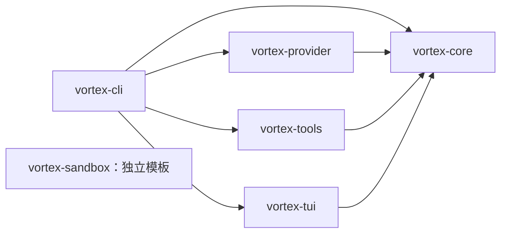

# 仓库与模块组织

核对日期：2026-10-26。本文描述当前目录及 Cargo 依赖；逻辑职责见
[模块视图](logical-modules.md)，未来拆分见 [架构演进](evolution.md)。

## 当前结构

```text
vortex/
├── Cargo.toml                  # 产品 Workspace 与统一依赖版本
├── Cargo.lock                  # 纳入版本管理的产品锁文件
├── README.md                   # 产品现状与实际验证记录
├── AGENTS.md                   # 修改边界与规范入口
├── CLAUDE.md                   # Claude Code 的规范入口
├── docs/
│   ├── architecture/           # 总览、逻辑模块、运行视图、物理组织、选型、演进与 ADR
│   ├── design/                 # 子系统详细契约
│   ├── engineering/            # 编码、测试、Git 与 Review 规范
│   ├── research/               # 调研与外部对照
│   └── guide/                  # 用户手册
└── crates/
    ├── vortex-cli/             # 唯一产品二进制 vortex
    ├── vortex-core/            # 配置、模型管理、运行时与共享接口
    ├── vortex-provider/        # 模型协议适配
    ├── vortex-tools/           # 具体工具及资源访问
    ├── vortex-tui/             # 交互与展示
    └── vortex-sandbox/         # 模板，未接入产品执行链
```

上图只列架构相关主目录。当前没有统一的 `rust-toolchain.toml` 或 CI 工作流；不将
未来工具链文件当作已存在入口。个人本地配置/临时文档不属于公共架构，操作遵守根规范。

## 实际 crate 依赖



箭头表示 manifest 中的兄弟 crate 依赖，不表示运行时消息方向。Core 可调用 Provider/Tool
的 trait 对象，但不反向依赖具体实现。Sandbox 没有入边或出边，尚未参与隔离。
HTTP 依赖存在于 CLI 的工厂/旧 exec、Provider 和网络工具；终端依赖只在 TUI。

## 执行链路的源码入口

以下路径相对 `crates/`，保留到职责级别，不要求按每个函数拆文件。

| crate | 当前模块与阅读入口 |
| --- | --- |
| `vortex-cli` | `src/main.rs` 分派模式；`paths.rs` 解析目录；`logging.rs` 初始化日志；`bootstrap.rs` 加载配置、注册工具并启动 Session；`model_factory.rs` 装配模型；`exec.rs` 是未迁移的单次 HTTP |
| `vortex-core` | `src/config.rs` 包含配置类型、合并、校验及文件加载；`model.rs` 管理绑定；`conversation.rs` 定义历史项；`provider.rs`/`tool.rs` 定义接口；`agent_loop.rs` 执行单轮；`session.rs` 包含公共连接与 actor；`lib.rs` 导出 API |
| `vortex-provider` | `src/openai_chat/mod.rs` 保存已装配实例；`options.rs` 转换思考字段；`thinking_presets.rs` 解析预设/覆盖；`request.rs` 映射 DTO；`decoder.rs` 组装增量；`stream.rs` 编排；`src/sse_transport.rs` 处理 HTTP/SSE |
| `vortex-tools` | `src/workspace_fs.rs` 管理根句柄与相对路径；`list_directory.rs` 有界枚举；`metaso_web_search.rs` 及其 `request.rs`/`response.rs` 负责搜索与映射；`mock_web_search.rs` 返回固定结果 |
| `vortex-tui` | `src/lib.rs` 入口与事件映射；`terminal.rs` 恢复终端；`event_loop.rs` 执行 Effect；`app.rs` 持有状态与 reducer；`action.rs` 定义 Action/Effect；`command.rs` 解析 slash；`ui.rs` 布局；`markdown.rs` 转换；`widgets/` 管理输入、菜单、模型窗口和 Transcript |
| `vortex-sandbox` | `src/lib.rs` 只有 Cargo 初始化模板，不是可调用的隔离实现 |

推荐从 `main → bootstrap → start_session` 理解装配，再沿 TUI 的
`event_loop → app::update → AgentHandle` 跟踪用户输入，最后阅读 Core 的
`session → run_turn → Provider/Tool`。配套图见 [运行链路](runtime-flows.md)。

测试主要位于实现文件末尾的 `#[cfg(test)] mod tests`，因此总行数不等于生产逻辑规模。
测试组织与 fixtures 规则见 [工程测试规范](../engineering/testing.md)。

## Workspace 约定

- 单一产品 Workspace，`members` 和 `default-members` 均为 `["crates/*"]`；根目录
  `--workspace` 覆盖所有成员，包含尚未接入的 sandbox 模板。
- 统一使用根 `Cargo.lock` 和默认 `target/`；锁文件纳入 Git，成员不单独维护锁文件。
- package/目录使用 `vortex-*`，Rust 引用为 `vortex_core::` 等；仅 CLI 产出 `vortex` 二进制。
- 共用依赖版本集中在根 `[workspace.dependencies]`，成员用 `workspace = true` 继承；
  features 以实际成员声明及 Cargo 合并结果为准，不能由依赖存在推断功能已经实现。
- 当前为 Rust 2024 edition、resolver 3；工具链与 CI 的统一固定仍需后续配置。
- 语言练习在独立项目维护，产品不得依赖个人学习项目。

依赖变动时共同提交相关 manifest 与根锁文件；纯文档整理不改这些文件。
