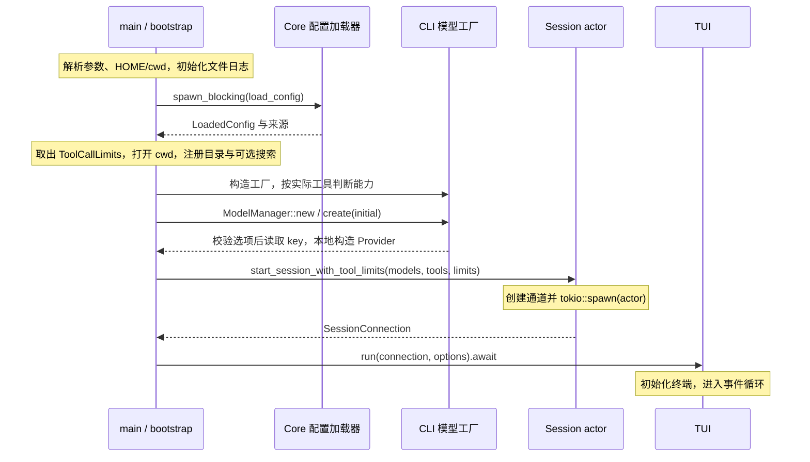
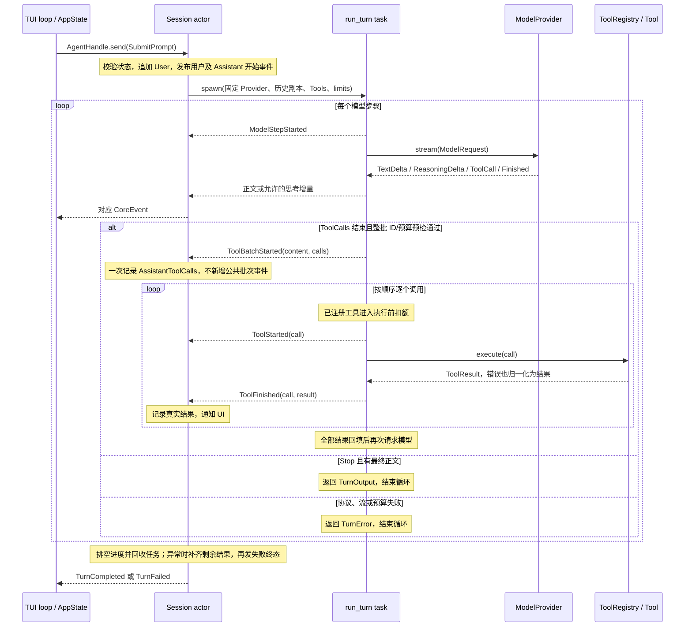
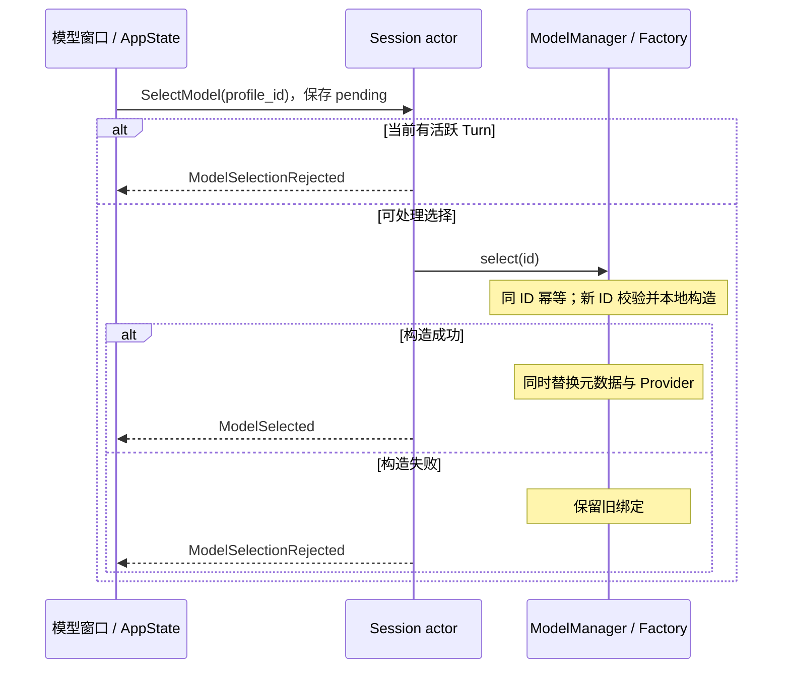

# 关键运行链路

核对日期：2026-10-30。本文展示当前 TUI 主链路；职责映射见 [逻辑模块](logical-modules.md)，
通道、状态和错误细节以 [Session 设计](../design/runtime/session-runtime.md) 为准。

## 1. 启动与对象装配

两个 Session 启动入口均启动并返回连接，不等待会话结束；`start_session` 使用默认规则。
TUI loop 在调用它的异步任务中
运行，Session actor 是另一个 Tokio task；接受 Prompt 后才创建本轮 Turn task。
它们由同一运行时调度，不要求各占一个线程。日志 guard 保持到 main 结束。

## 2. 一次 Prompt 与工具循环

图展示逻辑顺序，不表示正文、思考和工具增量在每个网络包中都同时存在。
一个 Turn 可包含多个模型步骤，每步可含多个调用；本地顺序执行，工具执行不是新 Turn。
调用次数按工具名累计：web_search 内置 4，其他工具默认 50；新用户 Turn 重置。
预检超限则整批不执行、不写声明，模型请求次数没有新增固定上限。

Session 的权威 history 与 Turn 的局部 context 分别更新。已完成工具结果保留，任务中途
异常时按待结果队列补齐已开始但未知及未开始的调用；Shutdown 不要求冲刷全部补齐事件。
最终成功 Assistant 只提交一次，失败步骤部分正文不提交。Thinking 仅向 UI 转发，
每步骤独立计数，不写模型历史。完整规则见 [Agent loop](../design/runtime/agent-loop.md)。

## 3. 消息与事件边界

| 数据 | 方向 | 意义 |
| --- | --- | --- |
| `AgentCommand` | TUI → Session | 用户意图；send 成功不等于业务已接受 |
| `ModelRequest` | Turn → Provider | 协议无关的完整历史项与工具定义 |
| wire 请求 / SSE data | Provider ↔ 外部模型 | HTTP 载荷和流帧，不进入 TUI/Core 的公共协议 |
| `ModelEvent` | Provider → Turn | 正文、思考、完整调用及单步结束原因 |
| `TurnProgress` | Turn → Session | 内部增量、步骤、批次声明及逐项结果，用于历史提交和事件发布 |
| `TurnOutput` / `TurnError` | Turn task → Session | 任务最终结果，不通过普通进度事件伪造完成 |
| `CoreEvent` | Session → TUI | 会话与选择结果的实时通知，不是持久化回放日志 |
| `UiAction` / `Effect` | TUI 内部 | 同步状态转换与待执行操作，不是模型协议 |

TUI `tokio::select!` 等待终端或 Core 事件，调用 `update`，再顺序执行 Effect。
重绘按现有 dirty 标志触发，没有固定 tick 节流。用户与错误文本、思考、Assistant
Markdown 都是展示投影，不从渲染结果反向构建模型请求。

## 4. 模型切换与确认

UI 收到确认后才更新当前模型；pending、窗口关闭与草稿保护见
[TUI 设计](../design/tui/interface.md#模型窗口与确认链)。选择不写配置、不清历史，
下一轮可能将已有历史发送给新的服务。当前 Turn 的 Provider 固定，不在中途替换。

## 5. Shutdown、背压与资源释放

命令 mpsc 容量为 32、公共事件为 128、每 Turn 的内部进度为 32。生产者等待容量，
避免任意丢增量；Session 先排空内部进度，再等待任务结果并发布单一终态。
事件队列满会向 Turn/Provider 传播背压。

`/exit` 的 Effect 顺序是发送 Shutdown 再退出 TUI。AgentHandle 将 Shutdown 写入独立
watch；actor 的等待和 `publish_event` 都观察该信号，随后 `abort_all` 请求中止活跃
Turn。命令端关闭或 UI 事件消费者丢弃也能使 actor 退出。

发送 Shutdown 不是任务完成确认，当前连接没有对外暴露 actor JoinHandle。
TUI 正常返回显式 cleanup，错误返回时由 TerminalGuard Drop 尝试恢复 raw mode、鼠标
和 alternate screen；不保证进程被强杀后的恢复，也不能替代真实终端验收。

丢弃流会取消本地消费，不证明服务端停止计算或计费。目录工具已开始的阻塞闭包不随
async task abort 被强制终止，其 permit 跟随后台工作；挂起 I/O 仍可能拖延运行时退出。
当前没有保留会话的 CancelTurn。

## 6. 旧 exec 的独立路径

`main` 完成路径和日志初始化后，exec 分支调用 `exec::execute`：读取固定的
`DEEPSEEK_API_KEY`、构造本地 DTO、向 DeepSeek 发非流式请求并打印结果。
该路径不加载 TUI 配置、不创建 Session，也不使用工具和 Thinking 展示；传入 `-m/-c`
当前会报错。它不代表 TUI 链路已经具有 system prompt 装配器。

让 exec 消费相同 Session 事件流是 [后续演进](evolution.md)，本轮文档整理不迁移代码。
