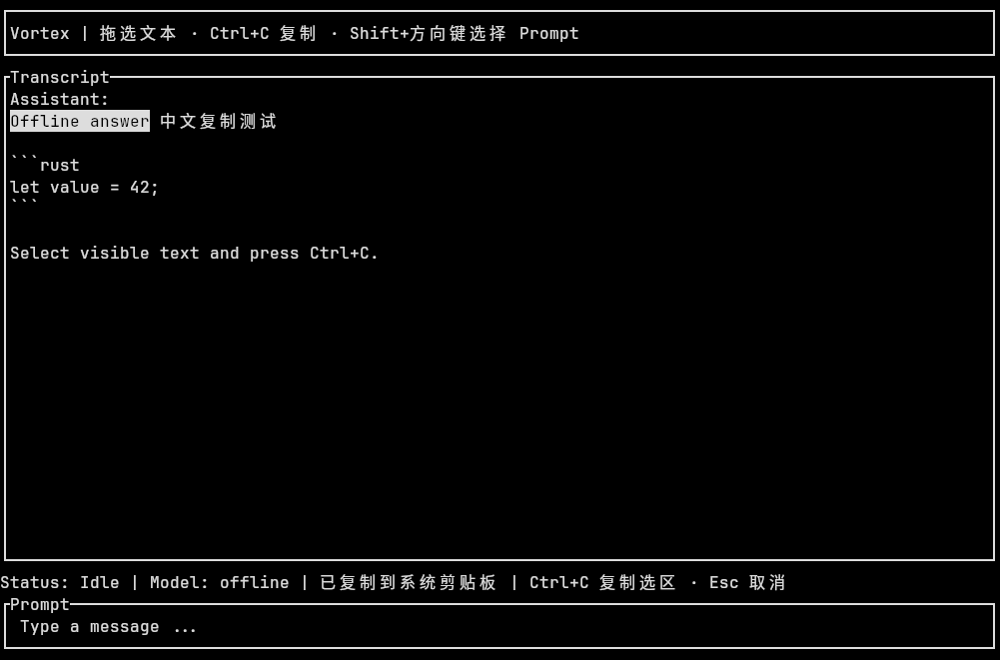

# 文本选择与系统剪贴板复制

核对日期：2026-10-28。对应 [Issue #4](https://github.com/AegeanZhang/vortex/issues/4)。
当前实现位于 TUI 的 `selection.rs`、`clipboard.rs`、`app.rs`、`ui.rs` 和 `event_loop.rs`。

## 用户交互

- 在 Prompt 或 Transcript 内容区按住鼠标左键拖选，反色显示选区；`Ctrl+C` 复制，`Esc` 取消。
- Prompt 也支持 `Shift+方向键` 创建编辑器选区，再用 `Ctrl+C` 写系统剪贴板。
  键盘选区使用原始草稿字符，不清空、提交或替换草稿；没有选区时只提示用法。
- 若终端将 `Ctrl+Shift+C` 交给应用，也按复制处理；通常它是终端自身的快捷键。
- 鼠标选区优先于编辑器键盘选区。根命令菜单或模型窗口打开时，先 Esc 关闭再复制。
- 保留已有鼠标滚轮、翻页、slash 和模型切换；复制不向 Core 发送命令，不改变会话状态。

## 复制内容与选区有效期

鼠标选择针对最后一次绘制的**当前可见文本**，不是整个历史或原始 Markdown。
`ui.rs` 在所有控件完成绘制后、选区高亮之前截取内容区单元格，排除边框、滚动条、标题栏、
状态栏和菜单。Transcript 内的角色标签、Thinking 标签与公开思考属于内容，选中后可复制。
代码块按实际显示复制，视觉换行保留为换行，去掉每行用于填充屏幕的尾部空格，保留行首缩进。
Prompt 的鼠标选择同样只复制可见部分；键盘选择则使用 TextArea 中的真实选区文本。

宽字符第二格映射回原字符起点；中文、组合字符和 emoji 不按 UTF-8 字节或占位格截断。
反向拖选支持同样规则。拖出控件时限制在起始控件内，不跨区拼接，不自动滚动或选择屏幕外历史。

滚动、Resize、编辑或提交草稿会取消鼠标选区；每次绘制也比较选中区域的文字和尺寸，
变化后取消，避免继续使用旧坐标复制错位内容。其他区域更新不影响当前选区：例如选择 Prompt
时，Transcript 的流式增量不会取消 Prompt 选区。菜单打开时不提供背景文本命中区域。
高亮使用反色属性，在 `NO_COLOR` 下仍有效，不依赖特定配色。

## 状态与执行边界

`AppState` 保存 `TextSelection` 展示状态；`update` 将显式复制转换为 `Effect::CopyText`。
事件循环持有剪贴板服务，将成功或固定安全错误转回 `UiAction::ClipboardResult`，状态栏呈现。
后台线程不操作 widget、终端或 Core。复制正文不进入日志，失败信息不透传平台错误链或内容。

系统访问使用 arboard 文本能力，关闭默认图像 features，启用 Wayland data-control。
剪贴板对象在首次明确复制时才创建，专用线程顺序写入并保留所有权；主事件循环不等待 OS 操作，
复制期间仍可响应 `/exit`。同一时间仅允许一个请求，单次 UTF-8 正文最多 1 MiB；超限或忙碌时
明确提示，不能静默截断代码。后台结果只含成功/失败，不携带正文。不主动读取原系统剪贴板。

线程接收端在服务释放后结束，剪贴板随之释放；不在退出时等待平台调用，也不承诺强制中断
已经开始的 OS 调用。Linux 上内容可能由本进程持有，没有剪贴板管理器时退出后可能丢失。
这不是后台剪贴板守护进程，也不增加剪贴板历史、自动复制或 Paste/bracketed-paste 支持。

## 平台与远程环境

| 环境 | 当前路径与验证边界 |
| --- | --- |
| Linux X11 / XWayland | arboard 原生文本剪贴板；已用隔离 Xvfb + Kitty 0.45.0 验证 |
| 原生 Wayland | 启用 data-control；取决于 compositor 支持及会话权限，尚未实机验证；有可用 X11 环境时库可回退 |
| Windows / macOS | arboard 平台实现，尚未进行原生构建与交互验收 |
| SSH、tmux、无图形会话 | 不隐式转发到本机、不自动发 OSC 52；缺少可用剪贴板时提示失败与终端原生复制方式 |

Kitty 可用 Shift 拖选、Ctrl+Shift+C 复制当前屏幕；这是终端能力，配置可能改变行为。
该路径也已在隔离 Kitty 验证，其他终端和 tmux 组合需各自确认。不把屏幕选择等同于取得
完整 Transcript 或恢复原始 Markdown，不把一次成功复制等同于已实现安全多行粘贴。

## 验证

离线测试覆盖事件映射、复制 Effect/草稿保护、菜单阻断、选区失效、宽字符/组合字符、
反向与跨行选择、命中限制、后台错误/串行/容量及释放。系统副作用通过注入 writer 隔离。
TestBackend 检查纯文本复制与实际高亮；测试数量及运行命令只在根 README 维护。

真实终端采用隔离虚拟显示中的 Kitty 和通过公共 API 装配的本地 Fixture Session，不调用
模型/搜索 API，不访问用户的桌面剪贴板。覆盖应用拖选、Prompt 键盘复制、独立进程读回、
原生终端复制、无桌面剪贴板反馈，以及正常/错误退出与 panic 后的终端恢复。截图为该测试窗口，不代表其他平台已验收：

